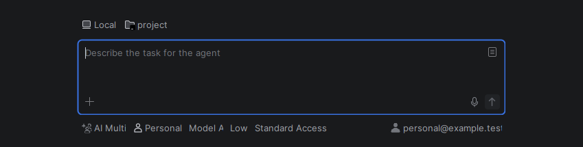

# AI Multi Profiles

**Your AI accounts and agents, one chat.**

Use personal and work AI profiles in IntelliJ IDEA's **AI Assistant** and **Air**. Switch accounts or agents and continue a conversation with the context you choose to share.

- Separate sign-ins for each profile.
- A **Default Profile** for each project.
- Profile switching inside a chat, or a new chat with another profile.
- Optional model and reasoning defaults for each profile.
- Your own model list: hide old or unused models and set a custom order, with your most-used model first.

## Quick start

Requires **IntelliJ IDEA 2026.2 build 262.10968 or newer**, AI Assistant or Air, Node.js and an installed ACP-compatible agent. Version **0.2.0 beta**.

1. **Install the plugin ZIP:** Settings > Plugins > gear menu > Install Plugin from Disk.
2. **Create a profile:** open Settings, search **AI Multi Profiles**, click **+**, name the profile and choose an installed agent. Click **Authorize…** to sign in. Optionally check **Default Profile**, then **Apply**. Repeat for another account.

3. **Start chatting:** open AI Chat, select **AI Multi**, then choose your profile beside it.

4. **Switch when needed:** select another profile. In an existing chat, choose **Continue Current Chat** and how much context to share, or **Start a New Chat**. Switching a chat's profile keeps the project's Default Profile unchanged.

*Screenshots use a test profile and example model. Available agents and models depend on your installation.*

[Detailed guide and troubleshooting](docs/detailed-guide.md) | [Architecture](docs/native-client-architecture.md) | [Development decisions](docs/decisions.md)

Independent community plugin by [boyko.dev](https://boyko.dev).

License decision pending; public source availability grants no additional usage rights. Existing third-party notices retain their terms.
