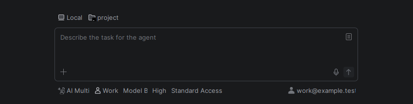
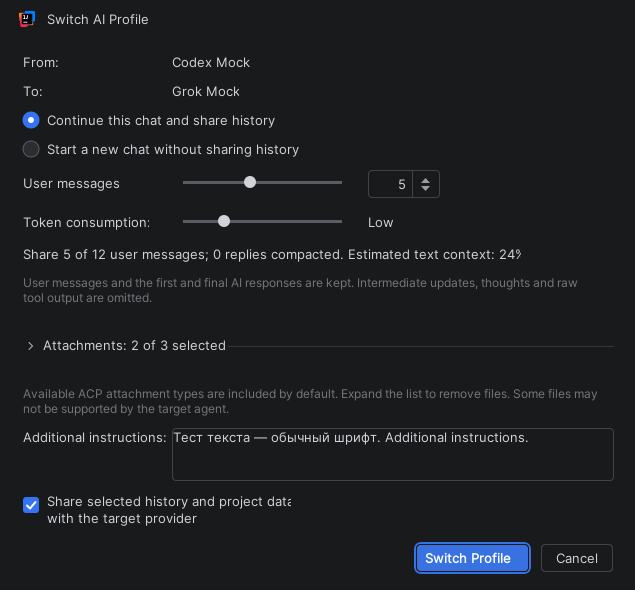

# AI Multi Profiles

**Your AI accounts and agents, one chat.**

Use personal and work AI profiles in IntelliJ IDEA's **AI Assistant** and **Air**. Switch accounts or agents and continue a conversation with the context you choose to share.

- Separate sign-ins for each profile.
- A **Default Profile** for each project.
- Profile switching inside a chat, or a new chat with another profile.
- Optional model and reasoning defaults for each profile.
- Your own model list: hide old or unused models and set a custom order, with your most-used model first.
- Account information in Air, so you can see which account the selected profile's agent is using.

## Quick start

Requires **IntelliJ IDEA 2026.2 build 262.10968 or newer**, AI Assistant or Air, Node.js and an installed ACP-compatible agent. Version **0.2.2 beta**.

1. **Install the plugin ZIP:** Settings > Plugins > gear menu > Install Plugin from Disk.
2. **Create a profile:** open Settings, search **AI Multi Profiles**, click **+**, name the profile and choose an installed agent. Click **Authorize…** to sign in. Optionally check **Default Profile**, then **Apply**. Repeat for another account.

3. **Start chatting:** open AI Chat, select **AI Multi**, then choose your profile beside it.

4. **Switch when needed:** select another profile. In an existing chat, choose **Continue Current Chat** and how much context to share, or **Start a New Chat**. Switching a chat's profile keeps the project's Default Profile unchanged.

*Screenshots use synthetic profiles and example models. Available agents and models depend on your installation.*

[Detailed guide and troubleshooting](docs/detailed-guide.md) | [Architecture](docs/native-client-architecture.md) | [Development decisions](docs/decisions.md)

Independent community plugin by [boyko.dev](https://boyko.dev).

Use is at your own risk under the [End User License Agreement](EULA.md). The plugin is free for personal and commercial use. It is source-available: publishing the source does not grant permission to copy, modify, redistribute, or commercially exploit it, and no open-source license is granted. To the extent permitted by law, the Developer is not liable for claims about how the plugin works or for any damage arising from its use. Existing third-party notices retain their terms.
